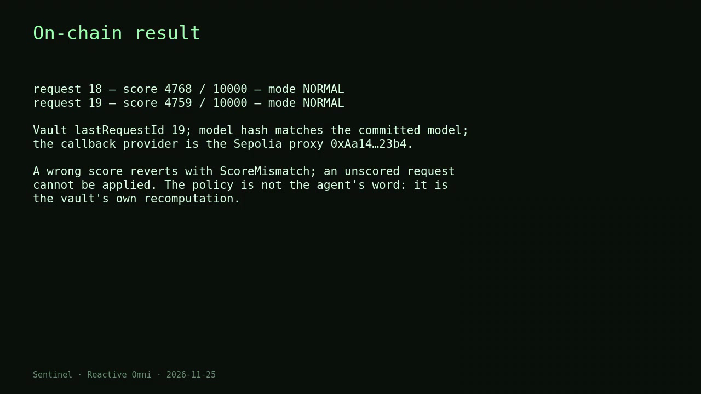

# Sentinel — an AI risk officer for on-chain vaults

**Reactive Omni Buildathon · Reactive Meets AI track**

## What you see in 30 seconds

Price events on Ethereum Sepolia become features on Reactive Lasna. The reactive
contract requests an AI assessment; a Python 6-8-1 MLP scores the regime; the
vault **recomputes the score on-chain** before it changes policy. The agent can
be late (a 180 s fallback goes defensive) but it cannot lie: a wrong score
reverts. The live loop applied request 18, score **4768 / 10000**, mode
**NORMAL**.



- **Live loop:** [tick](https://sepolia.etherscan.io/tx/0x2fd77f90cdbc34a4f33e5870174035c8f1e9bbc02baa9a8ad2a155b5b6cc09c2) → [reactive inference](https://lasna.reactscan.net/tx/0xe624133209086b347597744f4d2801ab2050df3895200aa7965fb6c5168f6db4) → [agent score 4768](https://sepolia.etherscan.io/tx/0x9d5bf2ce295fa66e99a9941a60e231ec8f7456daefe60c39ae63c562c36ca9f7) → [policy callback](https://sepolia.etherscan.io/tx/0xf1c343118e25bfb9eec10c81258dfdad5e996204e25dac1c7a2c1062a01d0b9f).
- **Code:** <https://github.com/matrixneoaiagent/reactive-omni-sentinel> · **Demo (2:24, inline):** <https://matrixneoaiagent.github.io/demo-media/sentinel.mp4>
- **AI is in the running loop:** the off-chain agent scores every request, and `SentinelVault.submitRiskScore` rejects any score that differs from its own integer forward pass.
- **Tests:** `forge test` → **38 passed, 0 failed** (contracts on both chain fixtures + 80 model / 76 feature parity vectors).
- **For judges:** [2-minute verification](#judge-verification-2-minutes) · [who can do what](#who-can-do-what) · [prior work](#what-existed-before-this-hackathon).

## What existed before this hackathon

This repository was created on **2026-11-25**, during the Reactive Omni
Buildathon. No Sentinel contract, agent, model, deployment or prior repository
existed before the event. The synthetic training data, the 6-8-1 model, the
Solidity inference export, the agent, tests, deploy scripts and video were all
produced for this submission.

Pre-existing material is limited to dependencies:

- `lib/forge-std/` and `lib/reactive-lib-omni/` (Reactive Network's Omni
  callback library, vendored at the pinned upstream commit).
- Python packages in `requirements.txt` (numpy, web3, eth-account).
- Standard ERC-20/price-feed interfaces; the feed is a demo publisher, not a
  copied production oracle.

The model is not a pre-trained third-party network: it is trained from scratch
on synthetic regime-switching paths generated by `training/generate_data.py`.

## How the loop works

Sentinel puts a small neural network inside a Reactive Network automation loop. Price events on Ethereum Sepolia become features on Reactive Lasna; the network asks an off-chain agent for an assessment; the agent's score is **recomputed and verified on-chain** before the vault changes its risk posture. If the agent is late, the reactive contract applies a conservative fallback instead of waiting forever.

> Thresholds cannot tell noise from a regime change. Sentinel scores the regime, and the contract — not the agent — decides what to do about it.

```
Ethereum Sepolia                Reactive Lasna                 Ethereum Sepolia
────────────────                ──────────────                 ────────────────
PriceTick ──▶ SentinelReactive ──▶ callback #1 ──▶ SentinelVault
(origin)        features              request          emits RiskAssessmentRequested
                                        │
                                        ▼
                                  AI agent (Python, 6-8-1 MLP)
                                        │ submitRiskScore
                                        ▼
                  SentinelReactive ◀── RiskScoreSubmitted
                        │
                        └──▶ callback #2 ──▶ SentinelVault.applyPolicy
                                              NORMAL / DEFENSIVE
```

## Why this needs Reactive Omni

The loop has two callback hops, and the second one only exists because the first produced an event. A keeper bot could do this with a cron job, but then the policy is off-chain and the audit trail is a database. Here every hop is a reactive transaction and a callback: the origin event, the inference request, the score, and the policy change are all on-chain and independently verifiable. Omni's ~1 s blocks and instant finality keep the reactive half of the loop fast; the origin chain's block time still sets the floor (Ethereum Sepolia ~12 s, Base Sepolia 200 ms). The point is auditability and automatic execution, not HFT latency.

## What is in the box

| Contract | Chain | Job |
|---|---|---|
| `PriceFeedOrigin` | Ethereum Sepolia (11155111) | Publishes `PriceTick(tickId, price, timestamp)`. A stand-in for a Chainlink adapter or DEX `Sync` subscription. |
| `SentinelReactive` | Reactive Lasna (5318007) | Subscribes to ticks and score events, keeps an 8-tick ring buffer, computes six integer features, requests inference, then requests the policy callback. Applies a timeout fallback. |
| `SentinelVault` | Ethereum Sepolia (11155111) | Holds user deposits. Accepts new deposits only in `NORMAL` mode. Verifies the agent's score against the committed model, applies hysteresis, and exposes the full request history. |
| `SentinelFeatures` | library | Deterministic integer feature extraction, mirrored in `training/features.py`. |
| `SentinelModel` | library | Integer-only 6-8-1 MLP inference, generated from `training/weights.json`. |

The origin/destination chain is switchable with `ORIGIN_CHAIN` in `deploy/config.env`:

| `ORIGIN_CHAIN` | Chain ID | Callback proxy | Reactive faucet |
|---|---|---|---|
| `sepolia` (default) | 11155111 | `0xAa14d9Cd0f788Ca23d11805986C1d8bd035D23b4` | `0x9b9BB25f1A81078C544C829c5EB7822d747Cf434` |
| `base-sepolia` | 84532 | `0x476F44b11F5C942c58f4c8E3d0300E5710743585` | `0x2afaFD298b23b62760711756088F75B7409f5967` |

Both are Lasna-testnet origins/destinations; the Reactive contract subscribes with the selected chain ID.

## The AI is in the loop, not in the build

The model is a 6-8-1 MLP with ReLU hidden units and a bounded linear output. It predicts the next five-tick return from six features:

| # | Feature | Intuition |
|---|---|---|
| 0 | 1-tick return × 20 | immediate move |
| 1 | 5-tick return × 10 | short trend |
| 2 | mean absolute return × 40 | realised volatility |
| 3 | drawdown from the 8-tick peak × 4 | how far below the high |
| 4 | 3-tick vol / 7-tick vol − 1 | volatility expansion |
| 5 | down-tick share over 5 ticks | trend consistency |

The output is mapped to a **0–10000 risk score**. `≥ 6500` enters `DEFENSIVE`; `≤ 4900` returns to `NORMAL`; the band between is a hysteresis zone that prevents flapping.

**Verification, not trust.** The weights are quantised to 1e6 and exported to Solidity. On submission the vault recomputes the forward pass from the stored features and rejects any score that does not match (`ScoreMismatch`). The agent is trusted for liveness only. A malicious agent can censor, but it cannot lie, and censorship is covered by the reactive timeout fallback.

### Held-out results

Synthetic regime-switching paths, 600 × 300 ticks, 25% of paths held out (43,500 samples). Full details in `training/metrics.json` and `docs/MODEL_CARD.md`.

| Metric (quantised model) | Sentinel | 1%-last-tick rule |
|---|---|---|
| R² | 0.179 | — |
| MAE | 0.143 | — |
| Recall of ≥1.5% five-tick drawdowns at the policy threshold | **35.0%** | 25.7% |
| False alarms on calm samples | 1.19% | 0.60% |

The model buys ~9 points of recall for ~0.6 points of extra false alarms. It is a small, honest edge on a noisy target, not a market-beating claim. The demo path is deterministic and reproduced in the Foundry E2E test.

## Safety properties

- **Agent cannot forge a score.** `SentinelVault.submitRiskScore` recomputes `SentinelModel.score(features)` and compares.
- **Agent cannot silently stop the guard.** If a request is unanswered for `fallbackDelay` (180 s), the next tick makes `SentinelReactive` request `applyFallback`, which puts the vault in `DEFENSIVE` without a score.
- **No stale scores.** The reactive contract tracks one in-flight request and ignores score events for any other request id.
- **No replay.** Tick ids are monotonic; duplicate price logs are ignored.
- **Hysteresis.** A single noisy score cannot flip the vault back and forth.
- **Deposits are never trapped.** `withdraw` works in both modes; only new deposits are blocked while defensive.
- **Callback authentication.** The vault checks both the callback proxy (`onlyServiceProvider`) and the injected reactive address (`onlyCallbackSender`), matching the production proxy behaviour.

## Who can do what

| Action | Who can call it | What it can do | What it cannot do |
|---|---|---|---|
| `deposit` | anyone | add ETH to the caller's balance, only while `NORMAL` | deposit while `DEFENSIVE`, or deposit for someone else |
| `withdraw` | any depositor | withdraw the caller's own balance, in both modes | withdraw another user's deposit or more than deposited |
| `submitRiskScore` | anyone (permissionless) | submit the score for an open request, once | choose a different score, reuse a request, or submit after it was applied — the score must equal the on-chain recomputation and model hash |
| `requestRiskAssessment` / `applyPolicy` / `applyFallback` | official proxy + registered reactive only | open one assessment, apply its stored score, or apply the no-score fallback | call from an EOA, change the stored score, or apply an unscored request |
| `processScore` | owner | request the policy callback after a missed score event | force a policy for an unscored request; the vault still reads and verifies its stored score |
| `setVault` / `setFallbackDelay` | owner | wire the vault, set the fallback window (30–3600 s) | move deposits, change a stored score, or bypass the model hash |
| **AI agent spend** | the Python agent (any submitter) | one gas transaction per open request | **cannot move, withdraw or deposit funds; cannot set the vault mode directly; cannot forge a score; cannot change the model, features or request id** |

The AI's only write is a score. The contract decides: `>= 6500` → `DEFENSIVE`,
`<= 4900` → `NORMAL`, and the band between holds the previous mode. A late or
silent agent triggers `applyFallback`, so censorship fails safe.

## Judge verification (2 minutes)

```bash
git clone https://github.com/matrixneoaiagent/reactive-omni-sentinel
cd reactive-omni-sentinel
forge test
# Expected: 38 tests passed, 0 failed, 0 skipped (38 total tests)
# No forge? nix-shell -p foundry --run 'forge test'

# The live vault still reports the loop's result
cast call 0xe006b89478eeAd20B34B8B7e8a2ef980Dd4760e6 "scoreOf(uint256)(uint16)" 18 \
  --rpc-url https://ethereum-sepolia-rpc.publicnode.com
# 4768
cast call 0xe006b89478eeAd20B34B8B7e8a2ef980Dd4760e6 "isDefensive()(bool)" \
  --rpc-url https://ethereum-sepolia-rpc.publicnode.com
# false
cast call 0xe006b89478eeAd20B34B8B7e8a2ef980Dd4760e6 "lastRequestId()(uint256)" \
  --rpc-url https://ethereum-sepolia-rpc.publicnode.com
# 19

cast receipt 0x9d5bf2ce295fa66e99a9941a60e231ec8f7456daefe60c39ae63c562c36ca9f7 \
  --rpc-url https://ethereum-sepolia-rpc.publicnode.com | grep -E "^status|^blockNumber"
# status                  1 (success)
cast receipt 0xf1c343118e25bfb9eec10c81258dfdad5e996204e25dac1c7a2c1062a01d0b9f \
  --rpc-url https://ethereum-sepolia-rpc.publicnode.com | grep -E "^status|^blockNumber"
# status                  1 (success)
```

The agent side is reproducible without a key:

```bash
python3 -m venv .venv && .venv/bin/pip install -r requirements.txt
.venv/bin/python -m pytest agent/test_agent.py -q
# Expected: 3 passed
```

The live addresses below are the **second** Sentinel deployment, whose
`_CALLBACK_SENDER` is `0x790e…F89D9` and whose `vault()` points back to
`0xe006…60e6`; `deployments/latest.json` preserves the earlier rehearsal record.

## Repository

```
src/
  PriceFeedOrigin.sol        origin event source
  SentinelReactive.sol       Lasna reactive contract
  SentinelVault.sol          origin/destination chain + policy
  lib/SentinelFeatures.sol   integer feature extraction
  lib/SentinelModel.sol      generated integer inference
  lib/ModelWeights.sol       generated quantised weights + hash
test/
  Vault.t.sol                auth, score verification, hysteresis, fallback
  Reactive.t.sol             subscriptions, feature window, replay, timeout
  E2E.t.sol                  calm → crash → recovery, full two-hop loop
  SepoliaPath.t.sol          same suites on Ethereum Sepolia + its proxy
  generated/                 80 model vectors + 76 feature vectors from Python
training/
  generate_data.py           regime-switching synthetic paths
  train.py                   MLP training, quantisation, Solidity export
  features.py                canonical integer features
  weights.json               committed model (hash in ModelWeights.sol)
  metrics.json               held-out results
agent/
  model.py                   integer inference, identical to Solidity
  agent.py                   event watcher, idempotent submitter, audit log
deploy/
  deploy.sh                  Sepolia or Base Sepolia + Lasna deployment, preflight, JSON record
demo/
  publish.sh                 publishes the 21-tick demo path
  monitor.py                 terminal dashboard
docs/
  RULES_VERIFICATION.md      official quotes, network, costs, unknowns
  ARCHITECTURE.md            sequence, auth, failure modes
  MODEL_CARD.md              data, metrics, limitations
  DEMO_SCRIPT.md             2:30 shot list
  SUBMISSION_CHECKLIST.md    form fields and evidence table
  DEPLOY_RUNBOOK.md          faucet → deploy → verify
  SEPOLIA_VALIDATION.md      both-chain tests + local deploy rehearsal output
```

## Reproduce

Requirements: Foundry, Python 3.11+, Node not required.

```bash
# contracts
forge test                      # 38 tests: both chains + cross-language parity
forge test --match-contract E2ETest -vvv

# python environment
python3 -m venv .venv && .venv/bin/pip install -r requirements.txt

# retrain from scratch (optional; weights are committed)
.venv/bin/python training/generate_data.py
.venv/bin/python training/train.py
.venv/bin/python training/export_feature_vectors.py
.venv/bin/python -m pytest agent/test_agent.py -q
```

`docs/test-output.txt` is the captured output of the last full run. The narrated
video was recorded when the suite had 36 tests; the owner-recovery test added
afterwards brings the current suite to 38 (all green).

### Local rehearsal (no testnet, no keys)

The full two-hop loop can be rehearsed on Anvil with a mock system contract and a mock callback proxy. This is for validation and video practice only; the addresses and hashes are local and must not be submitted as evidence.

```bash
./demo/local_demo.sh                          # Ethereum Sepolia chain id
ORIGIN_CHAIN=base-sepolia ./demo/local_demo.sh  # Base Sepolia variant
```

The Sepolia and Base variants use their respective chain IDs and callback-proxy addresses; the mock proxy's calldata injection is identical.

Expected: score 0 while the window fills, 4768 at tick 6, `DEFENSIVE` at tick 8 (8118), back to `NORMAL` at tick 18 (4790). `docs/test-output.txt` shows the Foundry version of the same path.

## Deploy and run

Deployment is **testnet only** and costs $0 in real funds; it needs Sepolia ETH from a faucet, which is also the input to the official Reactive faucet (1 ETH → 100 lREACT; **0.01 SepETH → 1 lREACT** is enough, keep the rest for gas). The default is Ethereum Sepolia; `ORIGIN_CHAIN=base-sepolia` switches the whole path. See `docs/DEPLOY_RUNBOOK.md` and the captured `docs/SEPOLIA_VALIDATION.md`.

```bash
cp deploy/config.env.example deploy/config.env
# ORIGIN_CHAIN=sepolia, RPC_ORIGIN, OWNER, and one auth method
# never commit this file
./deploy/deploy.sh --dry-run
./deploy/deploy.sh

# calm ticks, then the agent, then the crash
./demo/publish.sh --calm --interval 12
.venv/bin/python agent/agent.py --env-file deploy/config.env
./demo/publish.sh --crash --interval 12
./demo/publish.sh --recover --interval 12
```

## Deployed addresses and transactions

> **Status: live on Ethereum Sepolia + Reactive Lasna (2026-11-25).** The calm loop is applied (`mode 0`, `NORMAL`). The crash → `DEFENSIVE` and recovery → `NORMAL` path is exercised by the Foundry E2E test and the local Sepolia rehearsal (see `docs/SEPOLIA_VALIDATION.md`); the live second request (19) also applied `NORMAL`. No mainnet deployment and no purchase are required.

| Item | Value |
|---|---|
| PriceFeedOrigin (11155111) | `0x6F6f31D95c791aA3f7e61277E7e46Ff2BA3891D1` |
| SentinelReactive (5318007) | `0x790e35eF3F2aCA3Bec0418fBe14973CDC80F89D9` |
| SentinelVault (11155111) | `0xe006b89478eeAd20B34B8B7e8a2ef980Dd4760e6` |
| Origin tick tx (seed 18) | `0x2fd77f90cdbc34a4f33e5870174035c8f1e9bbc02baa9a8ad2a155b5b6cc09c2` |
| Reactive inference tx | `0xe624133209086b347597744f4d2801ab2050df3895200aa7965fb6c5168f6db4` |
| Inference request callback tx | `0x49354ae47f4438e67ddfeab7dfa62eeb949dd1383b1f7d68f52e953ab1fe64de` |
| Agent score tx | `0x9d5bf2ce295fa66e99a9941a60e231ec8f7456daefe60c39ae63c562c36ca9f7` |
| Reactive policy tx | `0xcf59d8c8bc5f0d81014faf0c1ba3773c7bc03ccfabf120af6105a76ac40618a4` |
| Policy callback tx (NORMAL) | `0xf1c343118e25bfb9eec10c81258dfdad5e996204e25dac1c7a2c1062a01d0b9f` |
| Model hash | `0x671b59e6a51dddd6ef2900c996807258f1a783a58ceff12ed5fe538af3d403e9` |

The exact evidence table and Etherscan/Reactscan link format are in `docs/SUBMISSION_CHECKLIST.md`. The live loop applied `NORMAL`; the `DEFENSIVE`/recovery variant is covered by `test/E2E.t.sol` and the local Sepolia rehearsal.

## Limitations and production path

- The price feed is a demo publisher, not a production oracle. Swapping in a Chainlink adapter changes only the event source.
- The model is trained on synthetic regimes. A production model needs real venue data, walk-forward validation, and a shadow-mode period before it can gate deposits.
- The agent is a single process. Production needs redundant agents, alerting, and a longer fallback window; the on-chain verification makes redundancy safe because every replica produces the same score.
- The score is verified on-chain, so changing the model requires deploying a new vault (or a model registry with timelocked hashes). That is intentional: the model is part of the trust surface.
- Testnet only. No audit. Do not use with real funds.

## Licence

MIT. See `LICENSE`.
