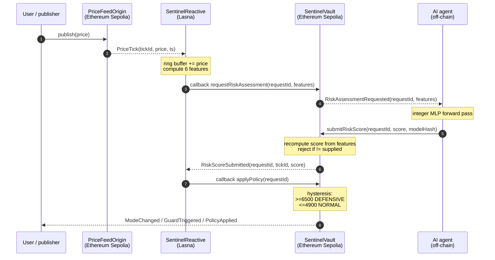

# Architecture

## Sequence



The **first callback** exists so the AI request is itself an on-chain event on the destination chain, where the agent can watch it with ordinary `eth_getLogs`. The **second callback** exists so the policy transition is executed by the reactive contract, not by the agent's transaction. The agent never has authority to change the mode; it only supplies a score that the vault can verify.

## Chain selection

The origin and destination are the same EVM testnet; the reactive contract lives on Lasna. `ORIGIN_CHAIN` selects the pair:

| `ORIGIN_CHAIN` | Chain ID | Callback proxy | Reactive faucet |
|---|---|---|---|
| `sepolia` (default) | 11155111 | `0xAa14d9Cd0f788Ca23d11805986C1d8bd035D23b4` | `0x9b9BB25f1A81078C544C829c5EB7822d747Cf434` |
| `base-sepolia` | 84532 | `0x476F44b11F5C942c58f4c8E3d0300E5710743585` | `0x2afaFD298b23b62760711756088F75B7409f5967` |

The contract source is chain-agnostic; the chain ID is passed to the constructor and stored in `ORIGIN_CHAIN_ID`, and `PRICE_FEED` / `vault` are bound at deployment. `SentinelVault` stores the selected callback proxy as its immutable `_SERVICE_PROVIDER`. `test/SepoliaPath.t.sol` re-runs the reactive, vault and E2E suites with the Sepolia values so the two paths cannot silently diverge.

## Contracts

### PriceFeedOrigin (Ethereum Sepolia, 11155111)

```solidity
event PriceTick(uint256 indexed tickId, uint256 price, uint256 timestamp);
function publish(uint256 price) external returns (uint256 id); // publisher only
```

`price` has 8 decimals (`2000e8`). `tickId` is monotonic and is reused as the request id. In production this contract is replaced by an adapter around a Chainlink aggregator or a DEX `Sync` event; the reactive subscription does not change.

### SentinelReactive (Lasna, 5318007)

State:

| Field | Purpose |
|---|---|
| `_prices[8]`, `_next`, `_count` | ring buffer of the last eight prices |
| `pending` | `(requestId, requestedAt, active)` — at most one in-flight inference |
| `lastPriceTickId` | replay / duplicate guard |
| `vault` | set once by the owner after the vault exists |
| `fallbackDelay` | 180 s default; owner can set 30–3600 s |

Subscriptions:

1. `(ORIGIN_CHAIN_ID, feed, PriceTick topic0, *, *, *)`
2. `(ORIGIN_CHAIN_ID, vault, RiskScoreSubmitted topic0, *, *, *)` — added by `setVault`, because the vault address is not known at construction.

`react()` routes on `(chainId, contractAddress, topic0)`, checks `lastPriceTickId`, decodes the log, pushes the price, and:

- if a pending request is older than `fallbackDelay`, requests `applyFallback` and clears it;
- if the window has ≥6 prices **and** no request is in flight, computes features and requests `requestRiskAssessment`.

Keeping one request in flight is deliberate: a five-tick crash should not produce five concurrent inference requests and a race between their scores. The next tick after a policy application starts a fresh assessment.

The reactive contract never trusts the score event's contents beyond the `requestId`; the vault already verified the score before emitting.

### SentinelVault (Ethereum Sepolia, 11155111)

Inherits `AbstractCallback`, so:

- `onlyServiceProvider` ensures the caller is the configured callback proxy;
- `onlyCallbackSender(reactive_)` ensures the first payload argument (injected by the network) is the authorised reactive contract.

The first argument of every callback signature is an `address` placeholder. The network writes the reactive sender there; the contract passes it to the modifier.

Request lifecycle:

```
requestRiskAssessment  →  requested (scored=false, applied=false)
submitRiskScore        →  scored    (score verified on-chain)
applyPolicy            →  applied   (mode may change)
applyFallback          →  applied   (mode=DEFENSIVE, no score)
```

Guards:

- duplicate `requestId` rejected (`requestedAt != 0`);
- score must equal `SentinelModel.score(features)`;
- `modelHash` must equal the committed hash;
- policy can only be applied once, and only after a score;
- fallback is rejected if a score already arrived, so a late fallback cannot overwrite a real assessment;
- score is rejected after a fallback, so a late agent cannot overwrite the safe default.

### Deterministic libraries

`SentinelFeatures` and `SentinelModel` are pure integer code. There is no floating point on-chain, no oracle for the model, and no admin override of the score.

The forward pass is:

```
h_j = relu( b_j + Σ_i trunc(f_i * W_ij / 1e6) )
o   = clamp( b_out + Σ_j trunc(h_j * V_j / 1e6), -1e6, 1e6 )
score = (o + 1e6) * 10000 / 2e6
```

`training/features.py`, `agent/model.py` and the Solidity use the same truncation order. `test/generated/ModelParity.t.sol` (80 vectors) and `FeatureParity.t.sol` (76 vectors) fail the build if they ever diverge.

## Authentication: verified against a live callback

The docs say the network replaces the first 160 bits of the callback payload with the reactive contract address. The exact offset matters: overwriting the first 20 bytes would destroy the 4-byte function selector.

On 2026-11-25 a live callback was decoded:

- Lasna `CallbackRequest` tx `0x5eba70cf0f1aae891e644e4e200e70ffa26a8a0ee311a4e62152fdbf5a69adb5`
- matching Ethereum Sepolia `deliverCallback` tx `0x56a544f0feed436d37a77a996c41b83dc360eb4c9f2c2573d9d92ce122769cfe`

The destination payload was:

```
fe0faba3
000000000000000000000000fbcdba49a040ca5965377f73bb327f2f2b7dc4c9   <- reactive sender
00000000000000000000000067ff755e233c3f550303c658ab8c55953f231a46
0000000000000000000000000000000000000000000000000000000000000001
```

The selector survived and the first argument carried the reactive contract. For a locally injected callback the equivalent operation is:

```solidity
mstore(add(payload, 36), sender)   // 32-byte data offset + 4-byte selector
```

This is exactly what `test/mocks/MockReactive.sol::MockProxy` does, which is why the E2E test exercises the same calldata shape as production.

## Failure modes

| Failure | Detection | Response |
|---|---|---|
| Agent offline | `pending.requestedAt + fallbackDelay` exceeded on the next tick | reactive requests `applyFallback`; vault goes `DEFENSIVE` |
| Agent submits a wrong score | vault recomputation | `ScoreMismatch` revert; request stays open for a correct retry |
| Agent submits a wrong model hash | hash comparison | `BadModelHash` revert |
| Agent censors a specific request | timeout | fallback as above |
| Duplicate tick log | `tickId <= lastPriceTickId` | ignored |
| Stale score log | `requestId != pending.requestId` | ignored |
| Callback out of gas | proxy emits `CallbackFailure` | request remains open; owner can raise `inferenceGasLimit`/`policyGasLimit` only before deployment (immutable defaults) |
| Vault in debt | proxy reverts `InDebt` | `coverDebt()` or `depositTo()` from the proxy |
| Reactive contract in debt | system contract blacklists it | `depositTo()` on the system contract |
| Model bug | parity tests | build fails before deployment |

## Gas and funding

- **Reactive side:** `react()` writes a few storage slots and computes 6 features plus ~56 multiplications. A 900k gas cap is comfortable. The contract pays in lREACT from reserves; fund with `SYSTEM.depositTo(reactive)`.
- **Destination side:** each callback is charged to the vault in origin-chain ETH. `depositTo(vault)` on the callback proxy creates reserves. 0.005 ETH is enough for hundreds of callbacks at testnet gas prices.
- **Callback gas limits:** 500k for `requestRiskAssessment`, 300k for `applyPolicy`/`applyFallback`. The proxy withholds overhead, so the effective limit is lower; both functions are well under 200k in tests.
- **Agent:** pays ordinary origin-chain gas for one `submitRiskScore` per request (~62–120k gas).

## Deployment order (circular dependency)

The vault needs the reactive address; the reactive contract needs the vault address to subscribe to score events. The cycle is broken on the reactive side:

1. deploy `PriceFeedOrigin` on the origin chain;
2. deploy `SentinelReactive` on Lasna with the feed address;
3. deploy `SentinelVault` on the origin chain with the reactive address;
4. call `reactive.setVault(vault)` on Lasna (subscribes to score events);
5. fund the reactive contract (lREACT) and the vault (origin-chain ETH).

`setVault` is one-shot and owner-only. `_CALLBACK_SENDER` in the vault is immutable, so a wrong reactive address requires redeploying the vault.
